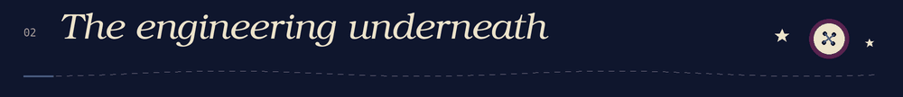

  

  <strong>Agent orchestration · MCPs · Backend development</strong> 
  Computer Engineering student at UNL · Learning Go

  <a href="https://www.linkedin.com/in/lucia-vidal-software-engineer">LinkedIn</a>
  &nbsp; ✦ &nbsp;
  <a href="mailto:lucividal09@gmail.com">Email</a>

<h2>
  
</h2>

Most of my current work happens in an **agentic development environment**. I use **agent orchestration and MCPs** to build software, and I propose improvements to the environment as I work with it. The workflow itself has become part of what I build.

On my desk right now: connecting **Meta's WhatsApp API** to a system of my own, and **learning Go**, with a basic working understanding of goroutines, channels, synchronization with `sync`, and pointers. A fair amount of this involves experimenting, reading documentation, and going back to the documentation.

<h2>
  
</h2>

My background is in end-to-end development for large-scale products in Latin America: **Java and Spring services, SQL data models, AWS integrations, and React and TypeScript frontends**. I've worked with reactive services, microfrontends, and automated testing.

I like being able to follow a feature through the whole system, from the data it stores to the interface someone actually uses.

| | What I work with |
| :--- | :--- |
| **Agents & tooling** | Agent orchestration · MCPs · Git · GitHub |
| **Backend** | Java · Spring · Node.js · Python · SQL · Go (learning) |
| **Frontend** | TypeScript · React · JavaScript · HTML & CSS |
| **Cloud & data** | AWS · PostgreSQL · Docker |
| **Engineering** | Reactive services · Microfrontends · Data modeling · Automated testing |

  

